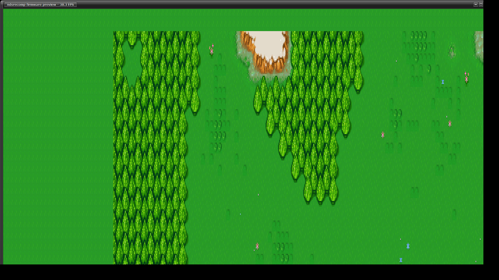
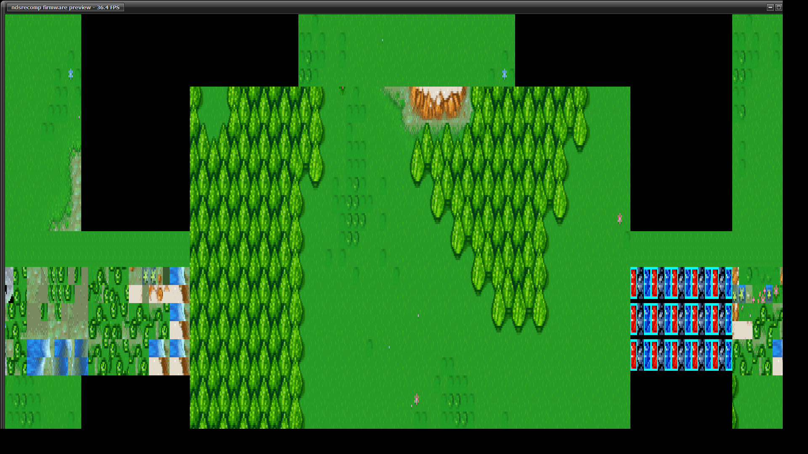

# 229 — A bigger screen shows more, not bigger

**Goal within the project:** adaptive window size, with two requirements:

* the game must extend with window size rather than stretch to fit, so a
  larger screen sees more of the battlefield instead of the same view blown up
  from its native resolution;
* fog and terrain must render correctly in the extended screenspace of
  adaptive widescreen.

Both are closed here, and the second turned out to be a consequence of fixing
the first.

## The complaint, measured

The sweep used to report the guest surface and nothing else, which is not
enough to see the fault. Two numbers are needed side by side:

* **magnification** — window pixels per guest pixel. The "is it blown up"
  number. It should be CONSTANT as the window grows.
* **field of view** — guest pixels over the DS's own 256×192. The "does a
  bigger screen show more" number. It should RISE as the window grows.

With both printed, the shipped behaviour is unambiguous:

```
640x480   -> 272x192 guest  mag 2.25x/2.24x  fov 1.06x/1.00x
800x600   -> 268x192 guest  mag 2.88x/2.87x  fov 1.05x/1.00x
1024x768  -> 266x192 guest  mag 3.74x/3.74x  fov 1.04x/1.00x
1280x720  -> 358x192 guest  mag 3.50x/3.49x  fov 1.40x/1.00x
1600x900  -> 392x212 guest  mag 4.01x/4.01x  fov 1.53x/1.10x
1920x1080 -> 472x212 guest  mag 4.01x/4.86x  fov 1.84x/1.10x
```

Read the first three rows: the window grows by 60% in each axis and the field
of view **falls**, 1.06× → 1.04×, while magnification climbs 2.25× → 3.74×.
That is the report, exactly: a bigger window bought nothing but bigger pixels.

## Why — and it was not the ceiling

The surface is sized `window / magnification`, which is the right rule. But it
is also capped from below so the DS's own 256×192 always fits:

```
capscale = min(win_w / 256, win_h / 192)
if (pixel_scale > capscale) pixel_scale = capscale
```

That cap is correct — showing *less* than the DS would be a regression — but it
means the magnification setting is only **honoured** in a window of at least
`256 × scale` by `192 × scale`. The default was 4.0, so that threshold was
1024×768. Every window up to and including a 1024×768 one therefore showed
precisely the DS's field, differing only in how large it was drawn.

**The default is 2.0 now.** The threshold falls to 512×384, which no real
window is below, so the field grows with the window everywhere:

```
640x480   -> 306x216 guest  mag 2.00x/2.00x  fov 1.20x/1.12x
800x600   -> 386x276 guest  mag 2.00x/2.00x  fov 1.51x/1.44x
1024x768  -> 498x360 guest  mag 2.00x/2.00x  fov 1.95x/1.88x
1280x720  -> 626x336 guest  mag 2.00x/2.00x  fov 2.45x/1.75x
1600x900  -> 786x426 guest  mag 2.00x/2.00x  fov 3.07x/2.22x
1920x1080 -> 946x512 guest  mag 2.00x/2.01x  fov 3.70x/2.67x   CEILING
```

Magnification is flat at 2.00× down the whole sweep and field of view rises
monotonically to 3.70× the DS's width. That is the required property, stated
as a measurement rather than an intention.

It is still a slider, 1.0× to 8.0×, and the panel now prints the three numbers
live beside it — a magnification control whose effect you can only see by
resizing the window and squinting is an unfinished control.

## The ceiling, raised, and the four places that have to agree

1920×1080 lands on the ceiling, so the ceiling was raised from 512×256 to
1024×512. A vertex's screen position is masked when it is latched;  the masks
were `0x1FF` in x and `0xFF` in y and are `0x3FF` and `0x1FF` now. Widening
them is inert on the vanilla path — at 256×192 a projected x never reaches 512
— so the mask only ever bites once the viewport is wider than the hardware's,
which is exactly the enhanced path. melonDS keeps a 13-bit `HiresPosition`
beside the masked one for its GL renderer on the same argument.

Four places have to agree or the surface silently stops growing in one axis:

| place | what it is |
|---|---|
| `GPU3D.cpp` vertex mask | `FinalPosition[0] & 0x3FF`, `[1] & 0x1FF` |
| `GPU3D_Soft.h` | `MaxRenderWidth`/`MaxRenderHeight`, which size the scanline buffers |
| `GPU3D.cpp` `SetRenderWidth`/`SetRenderHeight` | melonDS's own clamps |
| `gpu3d.cpp` `nds_gpu3d_set_output_*` | the runner's setters |

The height half of the last one was missed on the first pass, and the symptom
is worth recording because it is silent by construction: the setter returns
`false`, the frontend simply re-asks next frame, and the surface keeps whatever
height it already had. A 1893×1030 window sat at **212** rows while its width
tracked correctly beside it — visible in the sweep above as `mag 4.01x/4.86x`,
two magnifications that should have been equal.

## And then the terrain fell apart, which is the second requirement

Raising the ceiling exposed a bug that the old ceiling had been hiding.

`lb_widemap` serves the widened band out of three fixed tables covering
hardware tile columns −16..47 and rows −8..33. Those bounds were exactly right
for a 512×256 ceiling: `(512−256)/2 = 128` px of side band is 16 tiles, and
`(256−192)/2 = 32` px of top band is 4 rows, both inside the table with room to
spare. At 1024×512 the side band is **384** px — 48 tiles — so the outer two
thirds of each side would have fallen outside the tables.

A cell outside them is *declined*, and a declined cell is not blank: it falls
through to the hardware wrap and draws whatever the guest's tilemap happens to
hold out there. That is "the fog or terrain might not appear right in extended
screenspace" in its worst form.

The tables are now `−52..83` by `−24..47`, derived from the ceiling rather than
chosen:

```
side band = (1024 - 256) / 2 = 384 px = 48 tiles  -> columns -48..79
top band  = ( 512 - 192) / 2 = 160 px = 20 tiles  -> rows    -20..43
```

plus a few tiles of slack for the partial tile a scroll offset puts at each
end.

### Proving it, rather than asserting it

Enlarging the tables and then observing a clean run proves nothing on its own —
the run would look identical if the tables had never been the limit. So the
same binary can reproduce the old bounds: **`LB_EXTCLAMP=16`** narrows the
served band to 16 tiles either side, and a new counter reports how many cells
were declined for being outside the tables.

Same route, same six window sizes, one binary:

```
A (fixed)                B (LB_EXTCLAMP=16, the old bounds)
declined = 0             declined = 0          640x480   (306 wide, band 25px)
declined = 0             declined = 0          800x600   (386 wide, band 65px)
declined = 0             declined = 0          1024x768  (498 wide, band 121px)
declined = 0             declined =   263424   1280x720  (626 wide, band 185px)
declined = 0             declined =   985020   1600x900  (786 wide, band 265px)
declined = 0             declined =  2484160   1920x1080 (946 wide, band 345px)
```

The declines begin exactly at the fourth size, where the band first exceeds
16 tiles (185 px = 23.1 tiles). Not approximately there — at it.

And the pictures, both at 1920×1080:

|  |  |
|---|---|
| tables sized for the ceiling: one continuous map, no seam at the native boundary | tables sized for the old ceiling: black bands top and bottom, garbage terrain bottom-left, and raw UI sprite tiles bottom-right |

The right-hand picture is the hardware wrap, and it is what every window wider
than about 1280 would have shown.

**The invariant this establishes: `declined_out_of_table` is zero at every
window size.** It is printed every 120 frames, so a future ceiling change that
forgets the tables announces itself immediately instead of waiting for a
screenshot.

## One more silent skip: the gather rect stopped being encodable

`apply_cull_width` widens the entity gather rect by rewriting an ARM immediate,
so units out in the band are gathered and can be drawn and hit-tested there.
The right edge is `256 + (surface − 256)/2`, which lands on whatever the window
makes it — a 946-wide surface gives **601**.

An ARM data-processing immediate is an 8-bit value rotated by an even amount,
so above 255 it can only express multiples of 4, then 16, and so on. 601 is not
representable. `arm_imm12` returned 0 and the caller's `if (imm && …)` then
skipped the write **in silence**.

At the old ceiling the band was small enough that the value was usually
representable; raising the ceiling made unrepresentable values the common case.
So units at the outer edge of a wide band would have stopped being gathered, on
some window sizes and not others, with nothing in the log to say why — a fault
that would have read as "selection is broken again" and sent the next
investigation back to the touch path.

`arm_imm12_ceil` rounds up to the nearest representable value and the log says
what it wanted and what it got. Rounding *up* because the rect is a bound: a
few pixels too wide gathers a couple of entities the renderer then culls, while
a few too narrow drops entities the player can see.

```
[lb_cull] gather rect right edge camx+256 -> camx+444 px (band 185, wanted 441)
[lb_cull] gather rect right edge camx+256 -> camx+524 px (band 265, wanted 521)
[lb_cull] gather rect right edge camx+256 -> camx+604 px (band 345, wanted 601)
```

## The audits at the new size

The terrain and fog audits of docs/220 both stay clean at 946×512, across a
sweep of all six window sizes with panning:

```
[lb_audit]    2640 frames, 73 bad (worst 768 cells)      -- all at boot, flat after
[lb_fogaudit] frame 2400: EXACT on 768 fogged cells,
              running 0 verdict + 196 tile over 708096 cells   (0.028%)
```

Worth being precise about what that does and does not cover: those audits
compare the guest's own 32×24 window, which is exactly the region a too-small
table still serves correctly. **They would have passed identically on run B**,
the one whose picture is full of garbage. That is why the decline counter
exists: the audits check the model, and the counter checks the coverage, and
neither substitutes for the other.

## Cost

38 fps at 946×512 against 44 at 472×212 — the fill loop went from 42×64 cells
to 72×136, 3.6× the work, for 3.7× the field. Both are above the DS's 60 Hz
only because the runner is not frame-limited here; the figure to watch is the
ratio, and it is roughly linear in area rather than worse.
